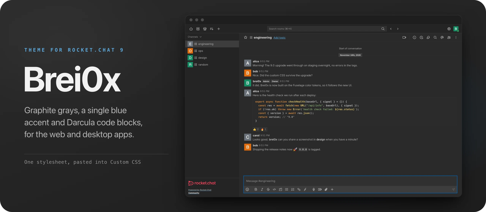
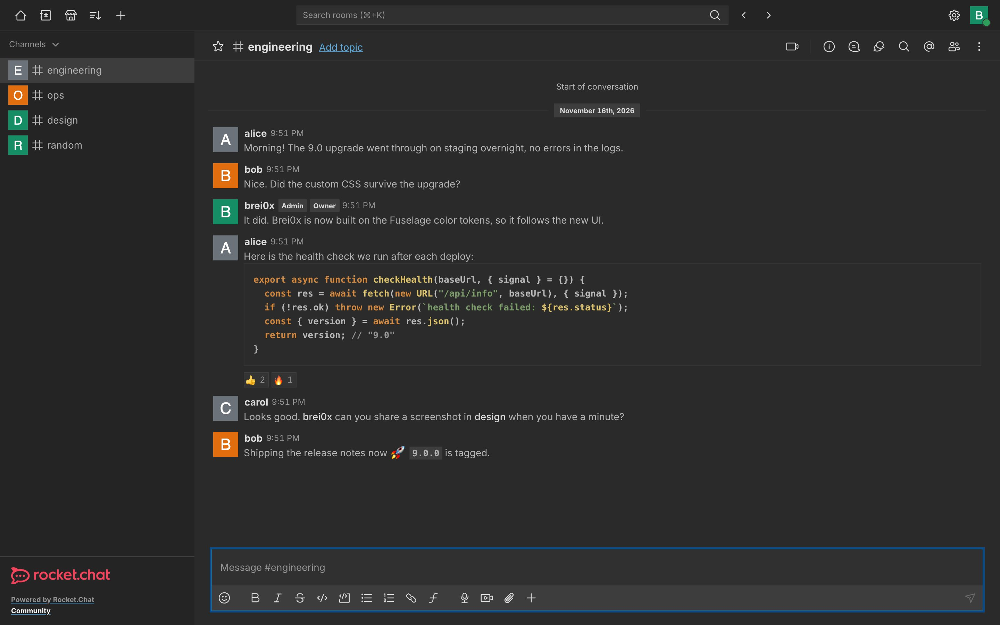

  

# Rocket.Chat Theme - Brei0x

Dark graphite theme for Rocket.Chat: neutral grays, a single blue accent, square corners
and Darcula-style code blocks.

  
  
  

---

## Prerequisites

- Rocket.Chat **9.0** or later, web client or desktop app. Built and checked on 9.0.0.
- An administrator account (permission `edit-privileged-setting`) to change the Custom CSS setting.

The theme is a single stylesheet that overrides Rocket.Chat's Fuselage color tokens. It does not
apply to the iOS and Android apps, which ignore Custom CSS.

## Install

1. Copy the content of [`brei0x.css`](brei0x.css).
2. Paste it in **Administration > Workspace > Settings > Layout > Custom CSS**, then save.
3. Reload the page.

Upgrade, removal and troubleshooting: [docs/SETUP.md](docs/SETUP.md).
Changes between versions: [releases](https://github.com/brei0x/rocketchat-dark-theme/releases).

## Screenshot

